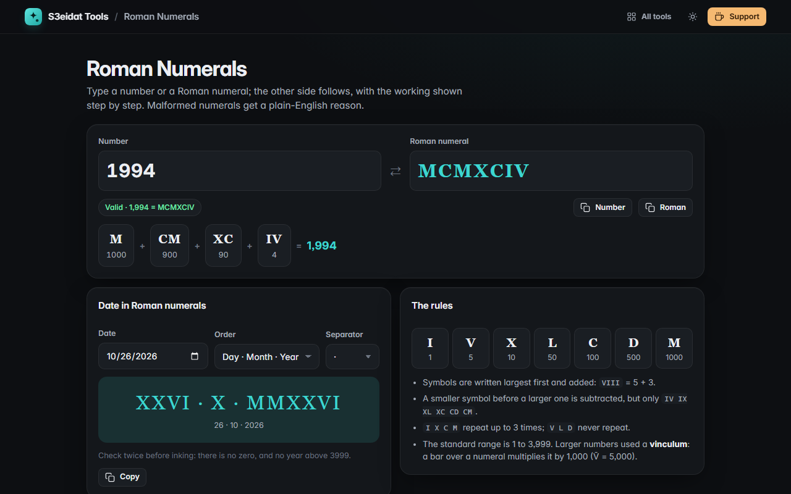

# Roman Numerals

> Convert numbers to Roman numerals and back, with the working shown. Free, private, and it runs entirely in your browser.

### ▶ [Open Roman Numerals](https://s3eidat.github.io/roman-numerals/)



## Features

- **Two-way**: type a number (1–3,999) or a Roman numeral and the other side follows
- **Step-by-step** breakdown: 1994 = M + CM + XC + IV, and MCMXCIV read symbol by symbol with + and −
- **Validation with reasons**: invalid symbols, repeats (IIII, VV), illegal subtractions (IC, VX) and non-standard forms (IXI) each get a plain-English explanation and the correct form
- **Vinculum** notation for 4,000 to 3,999,999 (a bar over a numeral multiplies it by 1,000), clearly marked as historical
- **Date to Roman numerals** for tattoos and engravings: day-month-year, month-day-year or year-month-day, with your choice of separator
- A quick reference of the symbols and rules; copy any result

## Privacy

Your numbers never leave your device. There is no server, no account, no analytics.
The page ships with a strict Content-Security-Policy (`connect-src 'self'`), so the browser
itself blocks any attempt to send data anywhere.

## Run it yourself

It's plain HTML, CSS and JavaScript with no build step:

```bash
git clone https://github.com/s3eidat/roman-numerals
cd roman-numerals
python -m http.server 8000
```

Then open http://localhost:8000.

## Support

If this saved you time, **[buy me a coffee ☕](https://s3eidat.github.io/coffee/)**. It keeps every tool free.

---

Part of **[S3eidat Tools](https://s3eidat.github.io/)**: 100+ free, private tools that run in your browser. MIT licensed.
